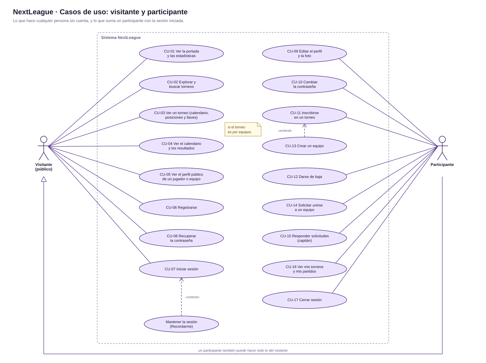
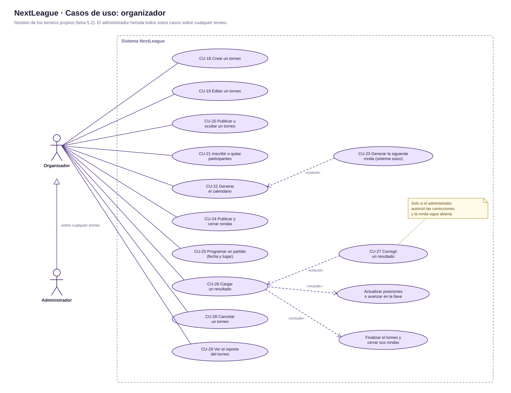
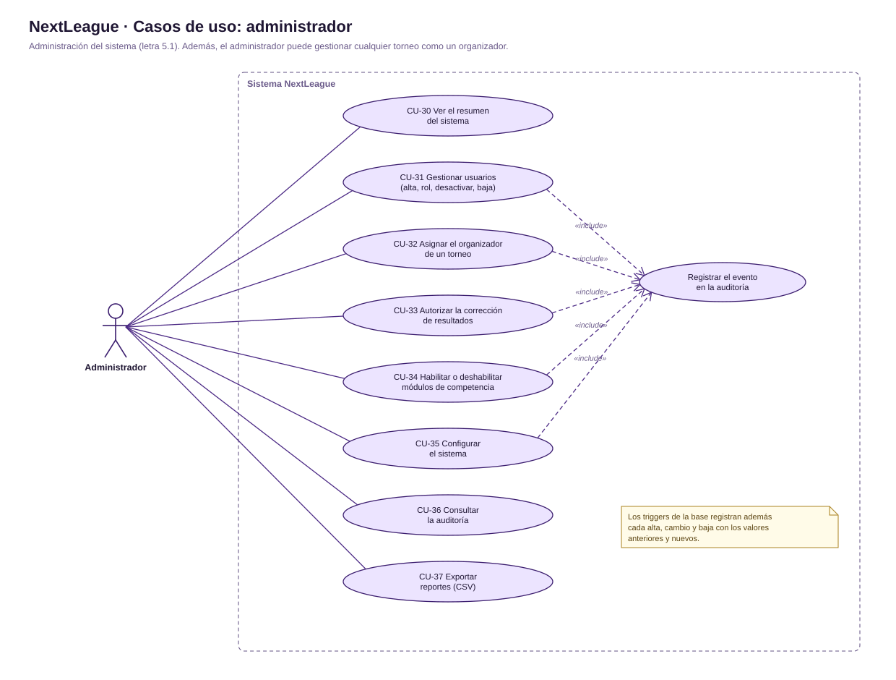

# NextLeague · Especificación de casos de uso

Proyecto de egreso · BT Tecnologías de la Información · ITS Arias-Balparda · 2026  
Versión 1.0 · 12 de octubre de 2026

Versión para imprimir: [casos_de_uso.pdf](casos_de_uso.pdf). Diagramas UML: [carpeta uml](uml/).

## Índice

1. [Introducción](#1-introducción)
2. [Actores](#2-actores)
3. [Diagramas de casos de uso](#3-diagramas-de-casos-de-uso)
4. [Reglas de negocio](#4-reglas-de-negocio)
5. [Especificación de los casos de uso](#5-especificación-de-los-casos-de-uso)
6. [Matriz de actores y casos de uso](#6-matriz-de-actores-y-casos-de-uso)

## 1. Introducción

**Propósito.** Este documento describe, caso por caso, lo que cada tipo de usuario puede hacer en NextLeague, una plataforma web para organizar torneos deportivos, mentales y electrónicos en tres formatos: liga, eliminación directa y sistema suizo.

**Alcance.** Cubre los 37 casos de uso de la aplicación web y su API. Las reglas salen del código (controladores, modelos y configuración) y de la letra del proyecto, punto 5 (roles y permisos).

**Convenciones.** Cada caso indica el actor principal, las precondiciones, el flujo principal numerado, los flujos alternativos (con el número del paso donde se desvían: 3a es una variante del paso 3), las postcondiciones, las reglas de negocio que aplica, la pantalla y el endpoint de la API.

### Glosario

| Término | Significado |
|---|---|
| Torneo | Competencia de una disciplina (juego) con un formato, una modalidad, un cupo y fechas de inicio y fin. |
| Módulo de competencia (formato) | Liga (todos contra todos), eliminación directa (llave) o sistema suizo (rondas por puntaje sin revanchas). El administrador puede deshabilitar un formato. |
| Modalidad | Individual (participa un usuario) o por equipos (participa un equipo con su capitán e integrantes). |
| Participante (inscripción) | Un usuario o un equipo inscripto en un torneo. Nunca las dos cosas a la vez. |
| Ronda | Grupo de partidos que se juega en una misma fecha. Pasa por tres estados: borrador, publicada y cerrada. |
| Enfrentamiento (partido) | Cruce entre dos participantes, con fecha, lugar y resultado. |
| Pase libre | Partido sin rival: el participante avanza (eliminación directa) o suma una victoria (suizo). |
| Resultado vigente | El último resultado cargado de un partido. Si se corrige, el anterior queda en el historial como no vigente. |
| Buchholz | Desempate del sistema suizo: la suma de los puntos de los rivales que enfrentó cada participante. |
| Auditoría | Registro de cada alta, cambio y baja de la base (con triggers), más los eventos de la aplicación, como un inicio de sesión. |

## 2. Actores

Los actores forman una jerarquía: cada uno puede hacer todo lo del anterior (el participante, lo del visitante; el organizador, lo del participante; el administrador, lo del organizador sobre cualquier torneo).

| Actor | Descripción |
|---|---|
| **Visitante (público)** | Cualquier persona que entra al sitio sin iniciar sesión. Solo consulta información publicada: torneos, calendarios, resultados, posiciones, llaves y perfiles públicos. También puede registrarse, iniciar sesión o recuperar su contraseña. Corresponde al rol "Público" de la letra (punto 5.4). |
| **Participante** | Usuario registrado. Se inscribe en torneos individuales, crea equipos o pide unirse a uno, y consulta sus torneos, sus próximos partidos y sus resultados. Hereda todo lo del visitante (letra, punto 5.3). |
| **Organizador** | Usuario con el rol de organizador. Crea y gestiona sus propios torneos: inscripciones, calendario, rondas, fechas, resultados y cancelación. También puede jugar torneos de otros organizadores, pero nunca uno propio (letra, punto 5.2). |
| **Administrador** | Gestiona todo el sistema: usuarios, módulos de competencia, configuración, reportes y auditoría. Puede gestionar cualquier torneo como si fuera su organizador, asignar el organizador a cargo y autorizar la corrección de resultados (letra, punto 5.1). |

## 3. Diagramas de casos de uso

### Visitante y participante

### Organizador

### Administrador

## 4. Reglas de negocio

| Código | Regla | Detalle |
|---|---|---|
| RN-01 | Roles | Hay tres roles con cuenta: administrador, organizador y participante. Al registrarse solo se elige participante u organizador; un administrador solo lo crea otro administrador. |
| RN-02 | Contraseñas | Entre 8 y 72 caracteres, con al menos una mayúscula, un número y un carácter especial. Se guardan cifradas (bcrypt), nunca en texto plano. |
| RN-03 | Bloqueo de ingreso | Tras 5 intentos fallidos (configurable) desde el mismo correo e IP, el ingreso se bloquea 15 minutos (configurable). |
| RN-04 | Sesión | Se cierra después de 120 minutos sin actividad (configurable). "Recordarme" la mantiene 30 días con un token que cambia en cada uso. Un usuario desactivado pierde el acceso en la petición siguiente. |
| RN-05 | Recuperación | El enlace para restablecer la contraseña vale 30 minutos (configurable) y sirve una sola vez. La respuesta del sistema es la misma exista o no la cuenta. |
| RN-06 | Administrador inicial | La cuenta que trae la instalación obliga a cambiar la contraseña en el primer ingreso. |
| RN-07 | Inscripción | Se puede inscribir mientras el torneo está pendiente y hasta que termina el día de inicio (después se cierra sola), con lugar en el cupo. El organizador no juega su propio torneo. Nadie se inscribe dos veces ni está en dos equipos del mismo torneo. |
| RN-08 | Equipos | Quien crea el equipo es su capitán. Los demás se suman con una solicitud que el capitán acepta, hasta el máximo de integrantes del torneo. El capitán no puede abandonar el equipo si tiene otros integrantes. |
| RN-09 | Baja | Darse de baja o quitar un participante solo es posible antes de que empiece el torneo. |
| RN-10 | Calendario | Se genera una sola vez, con al menos 2 inscriptos y mientras el torneo está pendiente. Las rondas quedan en borrador hasta publicarlas, y el torneo pasa a "en curso". |
| RN-11 | Formatos | Liga: todos contra todos (ida y vuelta opcional), con puntos por victoria, empate y derrota configurables. Eliminación directa: llave con pases libres, sin empates; el ganador avanza. Sistema suizo: rondas de a una, sin revanchas, el libre rota y suma una victoria, desempate Buchholz. |
| RN-12 | Fechas | Los partidos y las rondas se programan dentro de las fechas del torneo. Al editar el torneo, sus fechas no pueden dejar partidos afuera, y el inicio de un torneo pendiente no puede pasar al pasado. |
| RN-13 | Resultados | Se cargan en rondas publicadas, en partidos con dos rivales (no en pases libres) cuya fecha ya pasó o que no tienen fecha. En eliminación directa no hay empates; en liga y suizo, según la configuración del torneo. |
| RN-14 | Correcciones | Solo si el administrador autorizó el torneo y la ronda sigue abierta (una ronda cerrada es definitiva). En eliminación directa, solo si el ganador todavía no jugó el partido siguiente. El resultado anterior queda en el historial. |
| RN-15 | Finalización | Cuando no quedan partidos por jugar, el torneo pasa a "finalizado" y se cierran todas sus rondas. |
| RN-16 | Cancelar o borrar | Un torneo con calendario o resultados no se borra: se cancela y conserva lo jugado. Un torneo pendiente sin calendario se puede eliminar. Un torneo cancelado ya no se edita. |
| RN-17 | Visibilidad | El público solo ve los torneos publicados y las rondas publicadas. Un torneo oculto solo lo ven su organizador y el administrador. |
| RN-18 | Datos estructurales | El juego, el formato, la modalidad y el cupo solo cambian mientras el torneo tiene las inscripciones abiertas. El cupo no puede quedar por debajo de los inscriptos, y la modalidad no cambia si ya hay inscriptos. |
| RN-19 | Usuarios | Un usuario con torneos, equipos o resultados no se elimina: se desactiva, para no perder el historial. Siempre queda al menos un administrador activo, y un administrador no puede quitarse su rol, desactivarse ni eliminarse. |
| RN-20 | Módulos | Debe quedar al menos un formato habilitado. Deshabilitar uno impide crear torneos nuevos con él; los que ya lo usan siguen. |
| RN-21 | Auditoría | Los triggers registran cada alta, cambio y baja con los valores anteriores y nuevos. La cuenta de la aplicación puede agregar y leer la auditoría, pero no modificarla ni borrarla. |
| RN-22 | Archivos | Logo y foto de perfil: JPG, PNG o WebP de hasta 3 MB. Reglas: PDF de hasta 5 MB. Se valida el tipo real del archivo. |
| RN-23 | Permisos del administrador | Solo el administrador asigna el organizador de un torneo y autoriza la corrección de resultados. Los torneos empiezan sin esa autorización. |

## 5. Especificación de los casos de uso

### CU-01 Ver la portada y las estadísticas

| | |
|---|---|
| **Actor principal** | Visitante |
| **Descripción** | Muestra la página de inicio con los números del sistema, el torneo destacado, los torneos activos, los próximos partidos y los últimos resultados. |
| **Pantalla** | `home/` |
| **API** | `GET /estadisticas, /torneos/destacado, /torneos, /partidos/proximos, /partidos/recientes` |
| **Reglas** | RN-17 |

**Precondiciones**

- Ninguna.

**Flujo principal**

1. El visitante entra a la dirección del sitio.
2. El sistema muestra la portada.
3. El sistema muestra los totales de usuarios, torneos y equipos registrados.
4. Muestra el torneo destacado (con lugares libres), hasta seis torneos activos, los próximos partidos y los últimos resultados.
5. El visitante puede filtrar los torneos activos por categoría: deportivo, mental o electrónico.

**Flujos alternativos**

- 3a. El servidor no responde: se muestra "El sistema no está disponible", con un botón para reintentar.

**Postcondiciones**

- Ninguna: es una consulta.

### CU-02 Explorar y buscar torneos

| | |
|---|---|
| **Actor principal** | Visitante |
| **Descripción** | Lista los torneos publicados con filtros y paginación. |
| **Pantalla** | `torneos/explorar` |
| **API** | `GET /torneos?buscar=&categoria=&id_juego=&estado=&modulo=&pagina=` |
| **Reglas** | RN-17 |

**Precondiciones**

- Ninguna.

**Flujo principal**

1. El visitante entra a "Torneos".
2. El sistema lista los torneos publicados, de a doce por página.
3. El visitante filtra por texto, categoría, juego, estado o formato.
4. El sistema actualiza el listado y guarda los filtros en la dirección, para poder compartirla.
5. El visitante elige un torneo (sigue en CU-03).

**Flujos alternativos**

- 2a. No hay torneos que cumplan los filtros: se muestra un mensaje y la opción de limpiarlos.

**Postcondiciones**

- Ninguna: es una consulta.

### CU-03 Ver un torneo

| | |
|---|---|
| **Actor principal** | Visitante |
| **Descripción** | Muestra la ficha de un torneo y, en pestañas, su calendario, posiciones, llaves y participantes. |
| **Pantalla** | `torneos/torneo?id=` |
| **API** | `GET /torneos/{id}, /torneos/{id}/calendario, /torneos/{id}/posiciones, /torneos/{id}/participantes` |
| **Reglas** | RN-11, RN-17 |

**Precondiciones**

- El torneo está publicado.

**Flujo principal**

1. El visitante abre un torneo.
2. El sistema muestra la ficha: juego, formato, modalidad, fechas, premio, organizador, estado e inscripción.
3. El visitante recorre las pestañas: Resumen, Calendario (rondas publicadas con fecha, lugar y resultado), Posiciones (liga y suizo), Llaves (eliminación directa) y Participantes.
4. Si el torneo tiene reglas en PDF, puede descargarlas.

**Flujos alternativos**

- 1a. El torneo no existe o está oculto: "Torneo no encontrado" (salvo para su organizador y el administrador).
- 3a. Las rondas en borrador no se muestran al público.

**Postcondiciones**

- Ninguna: es una consulta.

### CU-04 Ver el calendario y los resultados

| | |
|---|---|
| **Actor principal** | Visitante |
| **Descripción** | Muestra los próximos partidos y los últimos resultados de todos los torneos publicados. |
| **Pantalla** | `torneos/partidos y torneos/partidos?vista=resultados` |
| **API** | `GET /partidos/proximos, /partidos/recientes` |
| **Reglas** | RN-17 |

**Precondiciones**

- Ninguna.

**Flujo principal**

1. El visitante entra a "Calendario" o a "Resultados".
2. El sistema lista los próximos partidos (desde hoy o sin fecha) o los últimos resultados.
3. El visitante puede filtrar por juego y abrir el torneo de cada partido.

**Flujos alternativos**

- 2a. No hay partidos para mostrar: se muestra un mensaje.

**Postcondiciones**

- Ninguna: es una consulta.

### CU-05 Ver el perfil público de un jugador o de un equipo

| | |
|---|---|
| **Actor principal** | Visitante |
| **Descripción** | Muestra la información pública de un jugador o de un equipo, sin datos privados. |
| **Pantalla** | `perfil/jugador?id= y perfil/equipo?id=` |
| **API** | `GET /usuarios/{id}, /equipos/{id}` |
| **Reglas** | El correo nunca se muestra en un perfil público. |

**Precondiciones**

- El jugador o el equipo existen.

**Flujo principal**

1. El visitante elige un jugador o un equipo desde un torneo, las posiciones o un partido.
2. Para un jugador, el sistema muestra su nombre, foto, biografía, estadísticas y los torneos en los que juega.
3. Para un equipo, muestra su torneo, el capitán y los integrantes.

**Flujos alternativos**

- 1a. No existe: "Usuario no encontrado" o "Equipo no encontrado".

**Postcondiciones**

- Ninguna: es una consulta.

### CU-06 Registrarse

| | |
|---|---|
| **Actor principal** | Visitante |
| **Descripción** | Crea una cuenta de participante o de organizador. |
| **Pantalla** | `register/register` |
| **API** | `POST /auth/registro` |
| **Reglas** | RN-01, RN-02 |

**Precondiciones**

- El registro está abierto (configuración "registro_abierto").

**Flujo principal**

1. El visitante elige "Registrarse".
2. Completa el nombre de usuario, el correo, la contraseña y su confirmación, y elige "Participar" u "Organizar".
3. Acepta las condiciones de uso.
4. El sistema valida los datos: nombre y correo únicos, y la política de contraseñas.
5. El sistema crea la cuenta con la contraseña cifrada.
6. El sistema inicia la sesión y lleva a la portada, o a la página desde la que venía.

**Flujos alternativos**

- 1a. El registro está cerrado: no se ofrece la opción.
- 4a. Hay datos inválidos o repetidos: el error se muestra junto a cada campo y no se crea la cuenta.
- 4b. Se intenta registrar una cuenta de administrador: se rechaza.

**Postcondiciones**

- Existe la cuenta y la persona tiene la sesión iniciada.

### CU-07 Iniciar sesión

| | |
|---|---|
| **Actor principal** | Visitante |
| **Descripción** | Ingresa al sistema con el correo y la contraseña. |
| **Pantalla** | `home/login` |
| **API** | `POST /auth/login` |
| **Reglas** | RN-03, RN-04, RN-06 |

**Precondiciones**

- La persona tiene una cuenta activa.

**Flujo principal**

1. La persona elige "Ingresar".
2. Escribe su correo y su contraseña, y opcionalmente marca "Recordarme".
3. El sistema verifica los datos y registra el intento.
4. El sistema inicia la sesión con un identificador nuevo, registra el último acceso y deja el evento en la auditoría.
5. Lleva a la página desde la que venía, o a la portada.

**Flujos alternativos**

- 3a. Los datos no coinciden: "Correo o contraseña incorrectos", con los intentos que quedan.
- 3b. Se superaron los intentos permitidos: el ingreso queda bloqueado por un tiempo.
- 3c. La cuenta está desactivada: no se permite el ingreso.
- 5a. La cuenta debe cambiar la contraseña (el administrador inicial): se la lleva al perfil para hacerlo.

**Postcondiciones**

- La sesión queda iniciada (y, con "Recordarme", se guarda un token de 30 días).

### CU-08 Recuperar la contraseña

| | |
|---|---|
| **Actor principal** | Visitante |
| **Descripción** | Permite elegir una contraseña nueva con un enlace enviado por correo. |
| **Pantalla** | `home/recuperar y home/restablecer?token=` |
| **API** | `POST /auth/recuperar, /auth/restablecer` |
| **Reglas** | RN-02, RN-05 |

**Precondiciones**

- Ninguna.

**Flujo principal**

1. La persona elige "¿Olvidaste tu contraseña?" y escribe su correo.
2. El sistema responde siempre con el mismo mensaje.
3. Si la cuenta existe, el sistema genera un token (guarda solo su hash) y envía el enlace por correo.
4. La persona abre el enlace y escribe la contraseña nueva dos veces.
5. El sistema valida el token y la política de contraseñas, guarda la nueva contraseña e invalida el token.

**Flujos alternativos**

- 5a. El enlace venció o ya se usó: se informa y se ofrece pedir uno nuevo.
- 5b. La contraseña no cumple la política: se muestra qué falta.

**Postcondiciones**

- La cuenta tiene la contraseña nueva.

### CU-09 Editar el perfil y la foto

| | |
|---|---|
| **Actor principal** | Participante |
| **Descripción** | Cambia los datos de la propia cuenta y la foto de perfil. |
| **Pantalla** | `perfil/perfil#cuenta` |
| **API** | `PUT /perfil, POST /perfil/foto, DELETE /perfil/foto` |
| **Reglas** | RN-22 |

**Precondiciones**

- La sesión está iniciada.

**Flujo principal**

1. El usuario entra a "Mi perfil" y luego a "Cuenta".
2. Cambia el nombre de usuario, el correo o la biografía, y guarda.
3. Opcionalmente sube una foto o quita la que tiene.
4. El sistema valida y guarda los cambios.

**Flujos alternativos**

- 4a. El nombre o el correo ya los usa otra cuenta: error junto al campo.
- 3a. La imagen no tiene un formato permitido o supera el tamaño máximo: se rechaza.

**Postcondiciones**

- El perfil queda actualizado (y la foto anterior se borra del servidor).

### CU-10 Cambiar la contraseña

| | |
|---|---|
| **Actor principal** | Participante |
| **Descripción** | Cambia la contraseña de la propia cuenta. |
| **Pantalla** | `perfil/perfil#cuenta` |
| **API** | `PUT /perfil` |
| **Reglas** | RN-02, RN-06 |

**Precondiciones**

- La sesión está iniciada.

**Flujo principal**

1. El usuario entra a "Mi perfil" y luego a "Cuenta".
2. Escribe la contraseña actual y la nueva dos veces.
3. El sistema verifica la actual y la política de contraseñas.
4. El sistema guarda la contraseña nueva.

**Flujos alternativos**

- 3a. La contraseña actual es incorrecta: no se cambia.
- 3b. La nueva no cumple la política: se muestra qué falta.

**Postcondiciones**

- La cuenta tiene la contraseña nueva.

### CU-11 Inscribirse en un torneo

| | |
|---|---|
| **Actor principal** | Participante |
| **Descripción** | El usuario se anota en un torneo individual. |
| **Pantalla** | `torneos/torneo?id=` |
| **API** | `POST /torneos/{id}/inscripcion` |
| **Reglas** | RN-07 |

**Precondiciones**

- La sesión está iniciada.
- El torneo está publicado y pendiente, dentro del plazo de inscripción y con lugar.
- El usuario no es el organizador del torneo.

**Flujo principal**

1. En la página del torneo, el usuario elige "Inscribirme".
2. El sistema verifica las condiciones de inscripción.
3. El sistema crea la inscripción y la registra en la auditoría.
4. Muestra "¡Listo! Ya estás inscripto".

**Flujos alternativos**

- 2a. El torneo es por equipos: se indica crear un equipo (CU-13) o pedir unirse a uno (CU-14).
- 2b. El cupo está completo: "El torneo ya completó su cupo".
- 2c. El usuario ya está inscripto.
- 2d. Pasó el día de inicio: "Las inscripciones se cerraron el …".
- 2e. Es el organizador: "no podés jugarlo".

**Postcondiciones**

- El usuario es participante del torneo.

### CU-12 Darse de baja

| | |
|---|---|
| **Actor principal** | Participante |
| **Descripción** | El usuario deja un torneo antes de que empiece. |
| **Pantalla** | `torneos/torneo?id=` |
| **API** | `DELETE /torneos/{id}/inscripcion` |
| **Reglas** | RN-08, RN-09 |

**Precondiciones**

- El usuario está inscripto (solo o en un equipo).
- El torneo todavía no empezó.

**Flujo principal**

1. En la página del torneo, el usuario elige "Darme de baja" y confirma.
2. El sistema quita la inscripción o, si juega en un equipo, lo saca del equipo.
3. Si era el único integrante del equipo, el equipo se elimina.

**Flujos alternativos**

- 1a. El torneo ya empezó: "no te podés dar de baja".
- 2a. Es el capitán y el equipo tiene más integrantes: no puede abandonarlo.

**Postcondiciones**

- El usuario ya no participa del torneo.

### CU-13 Crear un equipo

| | |
|---|---|
| **Actor principal** | Participante |
| **Descripción** | Inscribe un equipo nuevo en un torneo por equipos; quien lo crea queda como capitán. |
| **Pantalla** | `torneos/torneo?id=` |
| **API** | `POST /torneos/{id}/equipos` |
| **Reglas** | RN-07, RN-08 |

**Precondiciones**

- El torneo es por equipos, está abierto y tiene lugar.
- El usuario no está en otro equipo de ese torneo ni es su organizador.

**Flujo principal**

1. En la página del torneo, el usuario elige "Crear equipo" y escribe el nombre.
2. El sistema crea el equipo, lo inscribe como participante y deja al usuario como capitán e integrante.

**Flujos alternativos**

- 1a. Ya hay un equipo con ese nombre en el torneo.
- 1b. El cupo está completo.

**Postcondiciones**

- El equipo está inscripto y recibe solicitudes.

### CU-14 Solicitar unirse a un equipo

| | |
|---|---|
| **Actor principal** | Participante |
| **Descripción** | Pide al capitán de un equipo sumarse a él. |
| **Pantalla** | `torneos/torneo?id=#participantes` |
| **API** | `POST /equipos/{id}/solicitudes` |
| **Reglas** | RN-08 |

**Precondiciones**

- El torneo está abierto.
- El equipo tiene capitán y lugar.
- El usuario no está en otro equipo del torneo y no tiene una solicitud pendiente para ese equipo.

**Flujo principal**

1. En la lista de participantes, el usuario elige "Pedir unirme" en un equipo.
2. El sistema crea la solicitud pendiente.
3. Avisa que el capitán tiene que aceptarla.

**Flujos alternativos**

- 1a. El equipo no tiene capitán (lo inscribió el organizador): hay que pedirle al organizador que lo sume.
- 1b. Ya tiene una solicitud pendiente para ese equipo.

**Postcondiciones**

- Hay una solicitud pendiente para el capitán.

### CU-15 Responder solicitudes

| | |
|---|---|
| **Actor principal** | Participante (capitán) |
| **Descripción** | El capitán acepta o rechaza a quienes piden unirse a su equipo. |
| **Pantalla** | `torneos/torneo?id=#participantes` |
| **API** | `GET /equipos/{id}/solicitudes, POST /solicitudes/{id}/respuesta` |
| **Reglas** | RN-08 |

**Precondiciones**

- El usuario es el capitán del equipo.
- Hay solicitudes pendientes.

**Flujo principal**

1. El capitán ve las solicitudes pendientes de su equipo.
2. Elige aceptar o rechazar cada una.
3. Si acepta, el sistema suma a la persona como integrante; si rechaza, la solicitud queda rechazada.

**Flujos alternativos**

- 3a. La persona ya se sumó a otro equipo del torneo: la solicitud se rechaza sola.
- 3b. El torneo ya empezó: no se pueden sumar integrantes.
- 3c. El equipo llegó al máximo de integrantes.

**Postcondiciones**

- La solicitud queda respondida y el equipo actualizado.

### CU-16 Ver mis torneos y mis partidos

| | |
|---|---|
| **Actor principal** | Participante |
| **Descripción** | Muestra los torneos y partidos propios. |
| **Pantalla** | `perfil/perfil` |
| **API** | `GET /perfil, /perfil/torneos, /perfil/partidos` |
| **Reglas** | — |

**Precondiciones**

- La sesión está iniciada.

**Flujo principal**

1. El usuario entra a "Mi perfil".
2. El sistema muestra sus estadísticas y "Mis torneos": en los que juega y, si es organizador, los que organiza.
3. En "Mis partidos" muestra los próximos partidos y los últimos resultados, con "Gané" o "Perdí".

**Flujos alternativos**

- 2a. No tiene torneos: se ofrecen los torneos con inscripción abierta.

**Postcondiciones**

- Ninguna: es una consulta.

### CU-17 Cerrar sesión

| | |
|---|---|
| **Actor principal** | Participante |
| **Descripción** | Termina la sesión en el navegador actual. |
| **Pantalla** | `(menú del usuario)` |
| **API** | `POST /auth/logout` |
| **Reglas** | RN-04 |

**Precondiciones**

- La sesión está iniciada.

**Flujo principal**

1. El usuario elige "Cerrar sesión" en su menú.
2. El sistema registra el evento, borra el token de "Recordarme" y termina la sesión.
3. Lleva a la portada.

**Flujos alternativos**

- 1a. Un enlace o una imagen no pueden cerrar la sesión: la operación solo se acepta por POST con el token CSRF.

**Postcondiciones**

- No hay sesión en ese navegador.

### CU-18 Crear un torneo

| | |
|---|---|
| **Actor principal** | Organizador |
| **Descripción** | Da de alta un torneo con su configuración. |
| **Pantalla** | `createtournament/createtournament` |
| **API** | `POST /torneos` |
| **Reglas** | RN-11, RN-20, RN-22, RN-23 |

**Precondiciones**

- La sesión está iniciada con el rol de organizador o de administrador.
- Hay al menos un formato habilitado.

**Flujo principal**

1. El organizador elige "Crear torneo".
2. Completa el nombre, el juego, el formato, la modalidad, el cupo (de 2 a 256), las fechas, el premio y la moneda, la descripción, y opcionalmente el logo y las reglas en PDF.
3. Ajusta la configuración: puntos por victoria, empate y derrota, ida y vuelta, rondas del suizo, empates y máximo de integrantes.
4. Revisa la vista previa y guarda.
5. El sistema valida y crea el torneo (pendiente y publicado) con su configuración, y lo lleva a "Gestionar torneo".

**Flujos alternativos**

- 5a. Hay datos inválidos (por ejemplo, el fin antes del inicio, el inicio en el pasado o un formato deshabilitado): el error se muestra junto a cada campo.
- 5b. El archivo no tiene el formato permitido o supera el tamaño máximo.
- 2a. Si quien crea es el administrador, además elige el "Organizador a cargo" (CU-32).

**Postcondiciones**

- El torneo existe con las inscripciones abiertas y sin autorización para corregir resultados.

### CU-19 Editar un torneo

| | |
|---|---|
| **Actor principal** | Organizador |
| **Descripción** | Cambia los datos de un torneo propio. |
| **Pantalla** | `createtournament/createtournament?id=` |
| **API** | `POST /torneos/{id}` |
| **Reglas** | RN-12, RN-16, RN-18, RN-23 |

**Precondiciones**

- El usuario organiza el torneo o es administrador.
- El torneo no está cancelado.

**Flujo principal**

1. Desde "Gestionar torneo", el organizador elige "Editar torneo".
2. El formulario carga los datos actuales (el botón de guardar se habilita cuando terminan de cargar).
3. Cambia lo necesario y guarda.
4. El sistema valida los cambios y los guarda.

**Flujos alternativos**

- 4a. Intenta cambiar el juego, el formato, la modalidad o el cupo con el calendario generado: no se permite.
- 4b. El cupo quedaría por debajo de los inscriptos, o cambia la modalidad con inscriptos: no se permite.
- 4c. Las fechas dejarían partidos programados afuera, o el inicio de un torneo pendiente pasaría al pasado.
- 4d. Un organizador intenta reasignar el torneo o cambiar la autorización de correcciones: solo puede el administrador.

**Postcondiciones**

- El torneo queda actualizado y el cambio, auditado.

### CU-20 Publicar u ocultar un torneo

| | |
|---|---|
| **Actor principal** | Organizador |
| **Descripción** | Decide si el torneo es visible para el público. |
| **Pantalla** | `torneos/gestionar?id=` |
| **API** | `PUT /torneos/{id}/publicacion` |
| **Reglas** | RN-17 |

**Precondiciones**

- El usuario organiza el torneo o es administrador.

**Flujo principal**

1. En "Gestionar torneo", el organizador cambia el interruptor de publicación.
2. Si lo oculta, el torneo deja de aparecer en los listados y solo lo ven su organizador y el administrador.
3. Si lo publica, vuelve a aparecer.

**Flujos alternativos**

- 1a. Solo el organizador del torneo o un administrador pueden cambiarlo.

**Postcondiciones**

- El torneo queda publicado u oculto.

### CU-21 Inscribir o quitar participantes

| | |
|---|---|
| **Actor principal** | Organizador |
| **Descripción** | El organizador administra la lista de inscriptos. |
| **Pantalla** | `torneos/gestionar?id=` |
| **API** | `POST /torneos/{id}/participantes, DELETE /torneos/{id}/participantes/{idParticipante}` |
| **Reglas** | RN-07, RN-09 |

**Precondiciones**

- El usuario organiza el torneo o es administrador.
- El torneo está pendiente.

**Flujo principal**

1. En "Gestionar torneo", el organizador escribe el nombre de usuario del jugador; si el torneo es por equipos, el nombre del equipo y su capitán.
2. El sistema verifica las reglas de inscripción y agrega al participante.
3. Para quitar a alguien, el organizador elige "Quitar" y confirma; el sistema elimina la inscripción.

**Flujos alternativos**

- 2a. No existe un usuario activo con ese nombre, o ya está inscripto.
- 2b. Es el propio organizador: no puede jugar su torneo.
- 2c. El cupo está completo.
- 3a. El torneo ya empezó: no se pueden quitar participantes.

**Postcondiciones**

- La lista de inscriptos queda actualizada y auditada.

### CU-22 Generar el calendario

| | |
|---|---|
| **Actor principal** | Organizador |
| **Descripción** | Arma las rondas y los partidos según el formato del torneo. |
| **Pantalla** | `torneos/gestionar?id=` |
| **API** | `POST /torneos/{id}/calendario` |
| **Reglas** | RN-10, RN-11 |

**Precondiciones**

- El usuario organiza el torneo o es administrador.
- El torneo está pendiente, sin calendario y con al menos 2 inscriptos.

**Flujo principal**

1. En "Gestionar torneo", el organizador elige "Generar calendario" y confirma.
2. El sistema sortea el orden y arma las rondas: todas en liga, la llave con pases libres en eliminación directa, o la primera ronda en el sistema suizo.
3. Las rondas quedan en borrador, la inscripción se cierra y el torneo pasa a "en curso".

**Flujos alternativos**

- 1a. Hay menos de 2 inscriptos: "Hacen falta al menos 2 participantes".
- 1b. El calendario ya estaba generado: no se repite.

**Postcondiciones**

- El torneo está en curso con su calendario en borrador.

### CU-23 Generar la siguiente ronda (sistema suizo)

| | |
|---|---|
| **Actor principal** | Organizador |
| **Descripción** | En el sistema suizo, arma la ronda que sigue según los puntajes. Extiende CU-22. |
| **Pantalla** | `torneos/gestionar?id=` |
| **API** | `POST /torneos/{id}/rondas` |
| **Reglas** | RN-11 |

**Precondiciones**

- El torneo es suizo y está en curso.
- La ronda anterior tiene todos sus resultados.
- Quedan rondas por jugar.

**Flujo principal**

1. El organizador elige "Generar ronda N".
2. El sistema empareja por puntaje, sin repetir cruces; si son impares, el libre rota y suma una victoria.
3. La ronda queda en borrador para publicarla.

**Flujos alternativos**

- 1a. Faltan resultados: "Faltan resultados de la ronda N".
- 1b. Ya se jugaron todas las rondas.

**Postcondiciones**

- Existe la ronda nueva en borrador.

### CU-24 Publicar y cerrar rondas

| | |
|---|---|
| **Actor principal** | Organizador |
| **Descripción** | Controla cuándo una ronda es visible, cuándo admite resultados y cuándo es definitiva. |
| **Pantalla** | `torneos/gestionar?id=` |
| **API** | `POST /torneos/{id}/rondas/publicar, PUT /rondas/{id}` |
| **Reglas** | RN-13, RN-14, RN-17 |

**Precondiciones**

- El torneo tiene calendario.

**Flujo principal**

1. El organizador publica las rondas en borrador (todas juntas o de a una).
2. Las rondas publicadas se ven en la página del torneo y admiten resultados.
3. Cuando una ronda tiene todos sus resultados, la puede cerrar: sus resultados quedan definitivos.

**Flujos alternativos**

- 3a. Faltan resultados: "cargalos antes de cerrarla".
- 3b. Volver a borrador solo es posible si la ronda todavía no tiene resultados.

**Postcondiciones**

- Las rondas quedan en el estado elegido.

### CU-25 Programar un partido

| | |
|---|---|
| **Actor principal** | Organizador |
| **Descripción** | Asigna la fecha, la hora y el lugar de un partido. |
| **Pantalla** | `torneos/gestionar?id=` |
| **API** | `PUT /enfrentamientos/{id}` |
| **Reglas** | RN-12 |

**Precondiciones**

- El torneo tiene calendario.
- El partido no es un pase libre.

**Flujo principal**

1. En el editor de la ronda, el organizador elige la fecha y la hora, y escribe el lugar.
2. El sistema valida y guarda.

**Flujos alternativos**

- 2a. La fecha queda fuera del torneo: "Tiene que ser entre el … y el …".
- 1a. Un pase libre no se programa.

**Postcondiciones**

- El partido tiene fecha y lugar, visibles en el calendario.

### CU-26 Cargar un resultado

| | |
|---|---|
| **Actor principal** | Organizador |
| **Descripción** | Registra el resultado de un partido jugado y actualiza la competencia. |
| **Pantalla** | `torneos/gestionar?id=` |
| **API** | `POST /enfrentamientos/{id}/resultado` |
| **Reglas** | RN-13, RN-15 |

**Precondiciones**

- La ronda está publicada y no está cerrada.
- El partido tiene dos rivales y no es un pase libre.
- La fecha del partido ya pasó, o el partido no tiene fecha.

**Flujo principal**

1. El organizador escribe los puntajes de ambos rivales y guarda.
2. El sistema registra el resultado como vigente y marca al ganador.
3. El sistema actualiza las posiciones (liga y suizo) o hace avanzar al ganador en la llave (eliminación directa).
4. Registra el resultado en la auditoría.
5. Si no quedan partidos por jugar, finaliza el torneo y cierra sus rondas.

**Flujos alternativos**

- 1a. El partido es en el futuro: "Este partido está programado para el … Si ya se jugó, cambiá primero la fecha".
- 1b. Hay empate en un torneo que no lo permite.
- 1c. La ronda no está publicada: hay que publicarla antes.
- 1d. El partido ya tenía resultado: sigue en CU-27.

**Postcondiciones**

- El partido queda finalizado y la competencia, actualizada.

### CU-27 Corregir un resultado

| | |
|---|---|
| **Actor principal** | Organizador |
| **Descripción** | Reemplaza un resultado mal cargado, conservando el historial. Extiende CU-26. |
| **Pantalla** | `torneos/gestionar?id=` |
| **API** | `POST /enfrentamientos/{id}/resultado, GET /enfrentamientos/{id}/resultados` |
| **Reglas** | RN-14, RN-23 |

**Precondiciones**

- El administrador autorizó las correcciones en el torneo.
- La ronda sigue abierta.
- En eliminación directa, el ganador todavía no jugó el partido siguiente.

**Flujo principal**

1. El organizador vuelve a cargar los puntajes del partido, con una observación.
2. El sistema deja el resultado anterior como no vigente y registra el nuevo.
3. Recalcula las posiciones o la llave.
4. El historial del partido muestra todas las cargas.

**Flujos alternativos**

- 1a. El torneo no tiene la autorización: "Este torneo no permite corregir resultados. Pedíselo al administrador".
- 1b. La ronda está cerrada: los resultados son definitivos.
- 1c. El ganador ya jugó el partido siguiente de la llave.

**Postcondiciones**

- El partido tiene un resultado vigente nuevo y su historial.

### CU-28 Cancelar un torneo

| | |
|---|---|
| **Actor principal** | Organizador |
| **Descripción** | Da de baja un torneo sin perder lo jugado. |
| **Pantalla** | `torneos/gestionar?id=` |
| **API** | `POST /torneos/{id}/cancelar, DELETE /torneos/{id}` |
| **Reglas** | RN-16 |

**Precondiciones**

- El usuario organiza el torneo o es administrador.
- El torneo no está finalizado ni cancelado.

**Flujo principal**

1. En la zona de riesgo de "Gestionar torneo", el organizador elige "Cancelar torneo" y confirma.
2. El sistema pasa el torneo a "cancelado": conserva el calendario y los resultados, pero no admite más cambios.

**Flujos alternativos**

- 1a. Si el torneo está pendiente y sin calendario, también se puede eliminar del todo.
- 1b. Si tiene calendario o resultados, no se puede eliminar: solo cancelar.

**Postcondiciones**

- El torneo queda cancelado y el cambio, auditado.

### CU-29 Ver el reporte del torneo

| | |
|---|---|
| **Actor principal** | Organizador |
| **Descripción** | Descarga un archivo CSV con las posiciones y los partidos del torneo. |
| **Pantalla** | `torneos/gestionar?id=` |
| **API** | `GET /torneos/{id}/reporte` |
| **Reglas** | — |

**Precondiciones**

- El usuario organiza el torneo o es administrador.

**Flujo principal**

1. En "Gestionar torneo", el organizador elige "Descargar reporte".
2. El sistema arma el CSV con la tabla de posiciones y cada partido (ronda, rivales, resultado y fecha).

**Flujos alternativos**

- No tiene.

**Postcondiciones**

- Ninguna: es una consulta.

### CU-30 Ver el resumen del sistema

| | |
|---|---|
| **Actor principal** | Administrador |
| **Descripción** | Muestra el estado general del sistema. |
| **Pantalla** | `admin/admin#resumen` |
| **API** | `GET /admin/resumen` |
| **Reglas** | — |

**Precondiciones**

- La sesión está iniciada como administrador.

**Flujo principal**

1. El administrador entra a "Administración".
2. El sistema muestra los totales, los usuarios por rol, los torneos por estado, los partidos de la semana y la actividad reciente.

**Flujos alternativos**

- 1a. Un usuario sin el rol de administrador: "Esta sección es solo para administradores" (y la API responde 403).

**Postcondiciones**

- Ninguna: es una consulta.

### CU-31 Gestionar usuarios

| | |
|---|---|
| **Actor principal** | Administrador |
| **Descripción** | Alta, edición, cambio de rol, desactivación y baja de cuentas. |
| **Pantalla** | `admin/admin#usuarios` |
| **API** | `GET/POST /admin/usuarios, PUT/DELETE /admin/usuarios/{id}` |
| **Reglas** | RN-01, RN-04, RN-19, RN-21 |

**Precondiciones**

- La sesión está iniciada como administrador.

**Flujo principal**

1. El administrador entra a "Usuarios" y busca o filtra por rol y estado.
2. Puede crear un usuario con cualquier rol, editar sus datos o su rol, desactivarlo o reactivarlo, o eliminarlo.
3. El sistema valida y aplica el cambio, y lo registra en la auditoría.

**Flujos alternativos**

- 3a. El usuario tiene torneos, equipos o resultados: no se elimina, se desactiva.
- 3b. El administrador intenta quitarse el rol, desactivarse o eliminarse: no se permite.
- 3c. Quedaría sin administradores activos: no se permite.

**Postcondiciones**

- La cuenta queda actualizada. Si se desactivó, pierde el acceso en la petición siguiente.

### CU-32 Asignar el organizador de un torneo

| | |
|---|---|
| **Actor principal** | Administrador |
| **Descripción** | Elige qué organizador está a cargo de un torneo. |
| **Pantalla** | `createtournament/createtournament` |
| **API** | `POST /torneos, /torneos/{id} (campo id_organizador)` |
| **Reglas** | RN-23 |

**Precondiciones**

- La sesión está iniciada como administrador.

**Flujo principal**

1. Al crear o editar un torneo, el administrador elige el "Organizador a cargo" entre los organizadores activos.
2. El sistema guarda la asignación y la registra en la auditoría.

**Flujos alternativos**

- 1a. El usuario elegido no es un organizador activo: se rechaza.
- 1b. Un organizador intenta reasignar: solo puede el administrador.

**Postcondiciones**

- El torneo pasa a la gestión del organizador elegido.

### CU-33 Autorizar la corrección de resultados

| | |
|---|---|
| **Actor principal** | Administrador |
| **Descripción** | Permite que el organizador corrija resultados de un torneo. |
| **Pantalla** | `createtournament/createtournament?id=` |
| **API** | `POST /torneos/{id} (campo permitir_correcciones)` |
| **Reglas** | RN-14, RN-23 |

**Precondiciones**

- La sesión está iniciada como administrador.

**Flujo principal**

1. Al editar el torneo, el administrador marca "El organizador puede corregir resultados" y guarda.
2. El sistema guarda la autorización y la registra en la auditoría.

**Flujos alternativos**

- 1a. Un organizador intenta cambiarla: "La autorización para corregir resultados la da el administrador".

**Postcondiciones**

- El organizador puede corregir resultados (CU-27) mientras la ronda siga abierta.

### CU-34 Habilitar o deshabilitar módulos de competencia

| | |
|---|---|
| **Actor principal** | Administrador |
| **Descripción** | Decide qué formatos se pueden usar en los torneos nuevos. |
| **Pantalla** | `admin/admin#modulos` |
| **API** | `GET /admin/modulos, PUT /admin/modulos/{id}` |
| **Reglas** | RN-20 |

**Precondiciones**

- La sesión está iniciada como administrador.

**Flujo principal**

1. El administrador entra a "Módulos".
2. Cambia el interruptor de un formato.
3. El sistema guarda el cambio y lo audita.

**Flujos alternativos**

- 2a. Es el último formato habilitado: "Tiene que quedar al menos un formato habilitado".

**Postcondiciones**

- Los torneos nuevos solo ofrecen los formatos habilitados; los existentes siguen.

### CU-35 Configurar el sistema

| | |
|---|---|
| **Actor principal** | Administrador |
| **Descripción** | Ajusta los valores generales del sistema. |
| **Pantalla** | `admin/admin#configuracion` |
| **API** | `GET/PUT /admin/configuracion` |
| **Reglas** | RN-03, RN-04, RN-05, RN-22 |

**Precondiciones**

- La sesión está iniciada como administrador.

**Flujo principal**

1. El administrador entra a "Configuración".
2. Cambia el nombre del sitio, si el registro está abierto, los intentos y los minutos de bloqueo, la inactividad de la sesión, los días de "Recordarme", la validez del enlace de recuperación, los torneos por página o los tamaños máximos de archivo.
3. El sistema valida los valores, los guarda y los audita.

**Flujos alternativos**

- 3a. Algún valor no es válido para su tipo: no se guarda ninguno (se guardan todos o ninguno).

**Postcondiciones**

- El sistema usa los valores nuevos desde la petición siguiente.

### CU-36 Consultar la auditoría

| | |
|---|---|
| **Actor principal** | Administrador |
| **Descripción** | Revisa el historial de cambios y eventos del sistema. |
| **Pantalla** | `admin/admin#auditoria` |
| **API** | `GET /admin/auditoria` |
| **Reglas** | RN-21 |

**Precondiciones**

- La sesión está iniciada como administrador.

**Flujo principal**

1. El administrador entra a "Auditoría".
2. Filtra por rango de fechas, usuario, acción, tabla, origen o texto.
3. El sistema muestra cada registro con su origen (base o aplicación) y los valores anteriores y nuevos.

**Flujos alternativos**

- 2a. No hay registros con esos filtros: se muestra un mensaje.

**Postcondiciones**

- Ninguna: es una consulta.

### CU-37 Exportar reportes (CSV)

| | |
|---|---|
| **Actor principal** | Administrador |
| **Descripción** | Descarga listados del sistema para trabajarlos en una planilla. |
| **Pantalla** | `admin/admin#reportes` |
| **API** | `GET /admin/reportes/{usuarios|torneos|auditoria}` |
| **Reglas** | — |

**Precondiciones**

- La sesión está iniciada como administrador.

**Flujo principal**

1. El administrador elige el reporte: usuarios, torneos o auditoría.
2. El sistema genera y descarga el archivo CSV.

**Flujos alternativos**

- 1a. El tipo de reporte no existe: "Ese reporte no existe. Opciones: usuarios, torneos, auditoria".

**Postcondiciones**

- Ninguna: es una consulta.

## 6. Matriz de actores y casos de uso

● actor principal · ○ también lo puede hacer, porque hereda del actor anterior

| Caso de uso | Visitante | Participante | Organizador | Administrador |
|---|---|---|---|---|
| CU-01 Ver la portada y las estadísticas | ● | ○ | ○ | ○ |
| CU-02 Explorar y buscar torneos | ● | ○ | ○ | ○ |
| CU-03 Ver un torneo | ● | ○ | ○ | ○ |
| CU-04 Ver el calendario y los resultados | ● | ○ | ○ | ○ |
| CU-05 Ver el perfil público de un jugador o de un equipo | ● | ○ | ○ | ○ |
| CU-06 Registrarse | ● | ○ | ○ | ○ |
| CU-07 Iniciar sesión | ● | ○ | ○ | ○ |
| CU-08 Recuperar la contraseña | ● | ○ | ○ | ○ |
| CU-09 Editar el perfil y la foto |  | ● | ○ | ○ |
| CU-10 Cambiar la contraseña |  | ● | ○ | ○ |
| CU-11 Inscribirse en un torneo |  | ● | ○ | ○ |
| CU-12 Darse de baja |  | ● | ○ | ○ |
| CU-13 Crear un equipo |  | ● | ○ | ○ |
| CU-14 Solicitar unirse a un equipo |  | ● | ○ | ○ |
| CU-15 Responder solicitudes |  | ● | ○ | ○ |
| CU-16 Ver mis torneos y mis partidos |  | ● | ○ | ○ |
| CU-17 Cerrar sesión |  | ● | ○ | ○ |
| CU-18 Crear un torneo |  |  | ● | ○ |
| CU-19 Editar un torneo |  |  | ● | ○ |
| CU-20 Publicar u ocultar un torneo |  |  | ● | ○ |
| CU-21 Inscribir o quitar participantes |  |  | ● | ○ |
| CU-22 Generar el calendario |  |  | ● | ○ |
| CU-23 Generar la siguiente ronda (sistema suizo) |  |  | ● | ○ |
| CU-24 Publicar y cerrar rondas |  |  | ● | ○ |
| CU-25 Programar un partido |  |  | ● | ○ |
| CU-26 Cargar un resultado |  |  | ● | ○ |
| CU-27 Corregir un resultado |  |  | ● | ○ |
| CU-28 Cancelar un torneo |  |  | ● | ○ |
| CU-29 Ver el reporte del torneo |  |  | ● | ○ |
| CU-30 Ver el resumen del sistema |  |  |  | ● |
| CU-31 Gestionar usuarios |  |  |  | ● |
| CU-32 Asignar el organizador de un torneo |  |  |  | ● |
| CU-33 Autorizar la corrección de resultados |  |  |  | ● |
| CU-34 Habilitar o deshabilitar módulos de competencia |  |  |  | ● |
| CU-35 Configurar el sistema |  |  |  | ● |
| CU-36 Consultar la auditoría |  |  |  | ● |
| CU-37 Exportar reportes (CSV) |  |  |  | ● |
